| Nama | Raihan Nabil Mas'ud |
| NIM | 312510094 |

## Tujuan Praktikum

- Memahami sintaks dasar JavaScript dan cara menyisipkan JavaScript pada HTML.
- Menggunakan variabel, tipe data, operator, percabangan, perulangan, dan function.
- Menampilkan informasi melalui console, alert, prompt, dan elemen HTML.
- Memanipulasi konten serta gaya elemen HTML menggunakan JavaScript.
- Membuat interaksi sederhana pada form dan melakukan validasi input.
- Mendokumentasikan pekerjaan praktikum beserta hasil pengujiannya.

### Cara menjalankan

- Unduh atau clone repository `Lab5Web`.
- Buka `index.html` dengan klik dua kali (atau dengan ekstensi Live Server di VS Code). Halaman Mini Project dibuka lewat `mini_project.html`, dan soal 7 lewat `soal7.html`.
- Buka Console dengan menekan F12, lalu pilih tab Console (atau klik kanan, Inspect/Periksa, Console).
- Beberapa latihan memakai `prompt()` yang langsung muncul saat halaman dimuat. Agar tidak saling mengganggu, uji satu latihan per satu dengan memberi komentar (`//`) pada blok latihan lain di `script.js`.

## Latihan 1: Menampilkan Output

**Tujuan:** mengenali cara menampilkan output di halaman dan di Console.

```javascript
// script.js
document.getElementById("pesan").textContent = "Hello World";
console.log("Hello World");
```

**Langkah kerja:** buka `index.html` di browser, perhatikan teks pada halaman, lalu buka Console.

**Hasil:** teks pada paragraf `#pesan` berubah dari "Konten awal." menjadi "Hello World", dan Console juga menampilkan `Hello World`.

**Perbedaan output:** `textContent` mengubah isi elemen sehingga terlihat oleh pengguna di halaman, sedangkan `console.log()` hanya tampil di Console browser yang dipakai developer untuk memeriksa program.

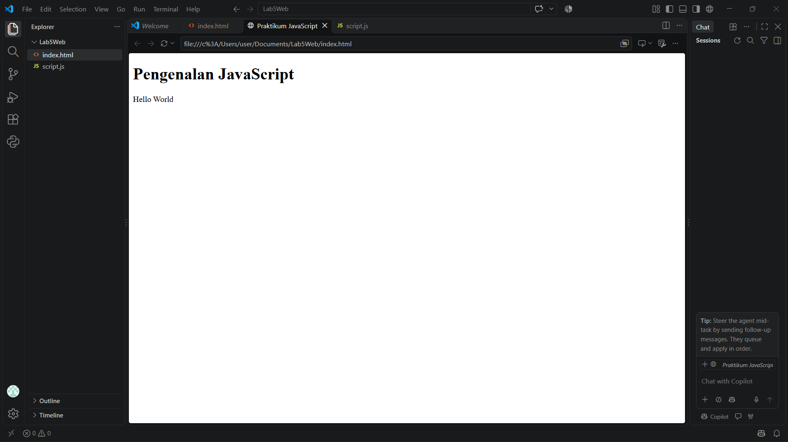
*Latihan 1: tampilan di halaman*

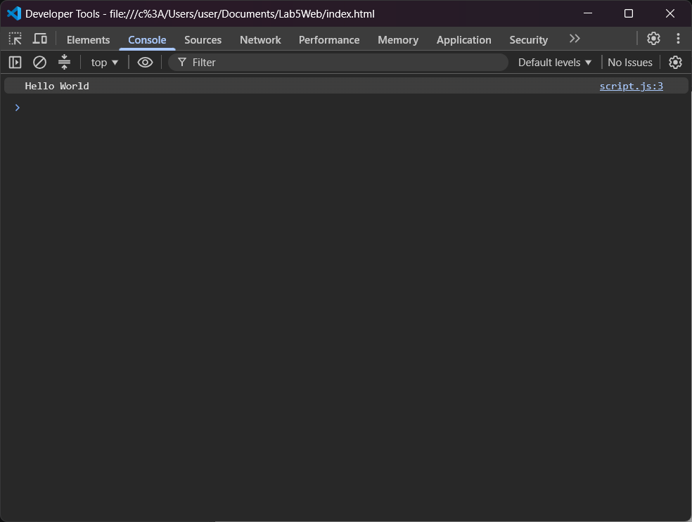
*Latihan 1: tampilan di Console*

## Latihan 2: Alert dan Prompt

**Tujuan:** meminta masukan dengan `prompt()` dan menampilkan pesan dengan `alert()`.

```javascript
const namaPengguna = prompt("Masukkan nama Anda:", "");
if (namaPengguna && namaPengguna.trim() !== "") {
  alert("Halo, " + namaPengguna + "!");
  document.getElementById("pesan").textContent = "Selamat datang, " + namaPengguna + ".";
} else {
  alert("Nama belum diisi.");
}
```

**Hasil pengujian:**

| Masukan | Perilaku program |
|---|---|
| Mengisi nama, misalnya `Rani` | Alert "Halo, Rani!", lalu teks halaman menjadi "Selamat datang, Rani." |
| Menekan Cancel | `prompt()` mengembalikan `null` (dianggap salah), sehingga alert "Nama belum diisi." |
| Membiarkan input kosong lalu OK | Hasilnya string kosong (dianggap salah), sehingga alert "Nama belum diisi." |
| Hanya mengetik spasi | `trim()` menjadikannya kosong, sehingga alert "Nama belum diisi." |

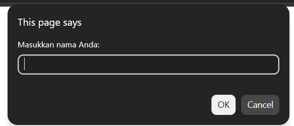
*Latihan 2: kotak prompt*


*Latihan 2: hasil setelah nama diisi*

## Latihan 3: Function dan Operasi Aritmetika

**Tujuan:** membuat function yang menerima dua bilangan lalu menampilkan hasil lima operasi aritmetika.

```javascript
function operasiDasar(a, b) {
  console.log("Penjumlahan:", a + b);
  console.log("Pengurangan:", a - b);
  console.log("Perkalian:", a * b);
  console.log("Pembagian:", b !== 0 ? a / b : "Tidak dapat dibagi nol");
  console.log("Modulus:", b !== 0 ? a % b : "Tidak dapat dibagi nol");
}

operasiDasar(9, 4);
```

**Catatan:** baris Modulus diberi pengecekan `b !== 0`, berbeda dari kode di modul. Tanpa pengecekan itu, `a % 0` menghasilkan `NaN`; dengan pengecekan, perilakunya konsisten dengan baris Pembagian.

**Hasil di Console** untuk `operasiDasar(9, 4)`:

```text
Penjumlahan: 13
Pengurangan: 5
Perkalian: 36
Pembagian: 2.25
Modulus: 1
```

Untuk `operasiDasar(10, 0)`, baris Pembagian dan Modulus menampilkan "Tidak dapat dibagi nol".

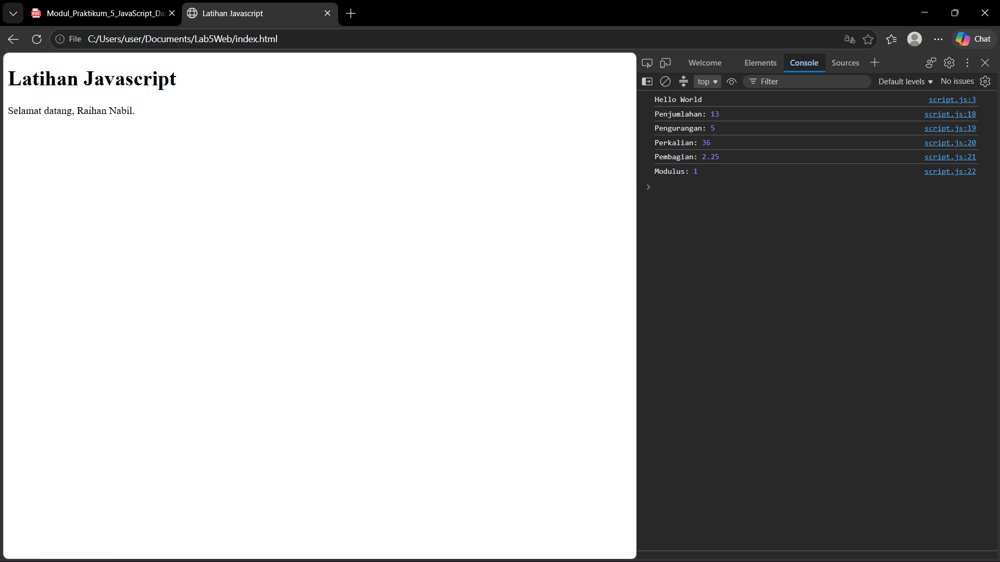
*Latihan 3: hasil di Console*

## Latihan 4: Seleksi Kondisi if–else

**Tujuan:** menentukan kelulusan dengan `if–else` (nilai minimal 60). Hasil `prompt()` selalu berupa string, sehingga dikonversi dengan `Number()`.

```javascript
const inputNilai = prompt("Masukkan nilai (0–100):");
const nilaiMahasiswa = Number(inputNilai);

if (inputNilai === null || inputNilai.trim() === "" ||
    Number.isNaN(nilaiMahasiswa) || nilaiMahasiswa < 0 || nilaiMahasiswa > 100) {
  alert("Input nilai tidak valid.");
} else if (nilaiMahasiswa >= 60) {
  alert("Lulus");
} else {
  alert("Belum lulus");
}
```

**Hasil pengujian:**

| Masukan | Hasil |
|---|---|
| 85 | Alert "Lulus" |
| 60 (batas) | Alert "Lulus" |
| 59 | Alert "Belum lulus" |
| 101 | Alert "Input nilai tidak valid." |
| `abc` | Alert "Input nilai tidak valid." |
| Kosong atau Cancel | Alert "Input nilai tidak valid." (`Number("")` bernilai 0, jadi dicek lebih dulu) |

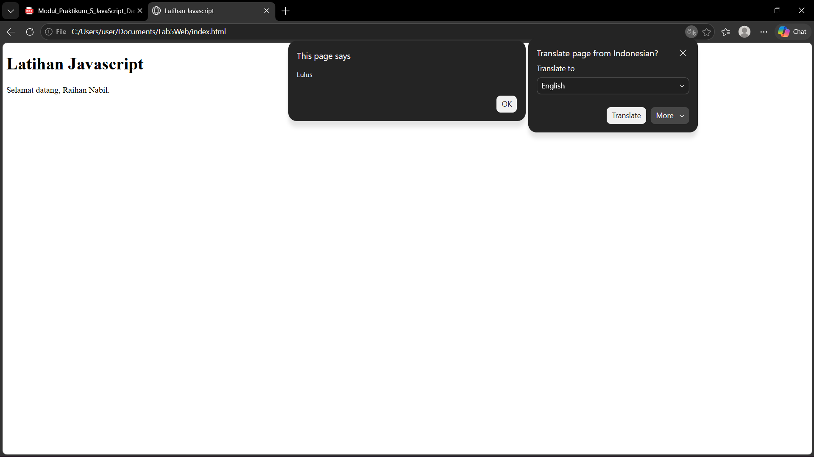
*Latihan 4: nilai lulus*


*Latihan 4: nilai belum lulus*

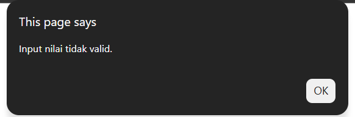
*Latihan 4: input tidak valid*

## Latihan 5: Seleksi Kondisi switch

**Tujuan:** menampilkan nama bilangan dari angka 1–5 menggunakan `switch`.

```javascript
const inputPilihan = prompt("Masukkan angka 1–5:");
switch (inputPilihan) {
  case "1": alert("Bilangan satu"); break;
  case "2": alert("Bilangan dua"); break;
  case "3": alert("Bilangan tiga"); break;
  case "4": alert("Bilangan empat"); break;
  case "5": alert("Bilangan lima"); break;
  default: alert("Pilihan tidak tersedia");
}
```

**Hasil pengujian:** angka 1 sampai 5 menampilkan alert "Bilangan satu" sampai "Bilangan lima". Angka di luar rentang (misalnya `7`), huruf, input kosong, atau Cancel menampilkan "Pilihan tidak tersedia" melalui `default`. Pembandingan `case` bersifat ketat, sehingga `case "1"` (string) cocok dengan hasil `prompt()` yang juga string.

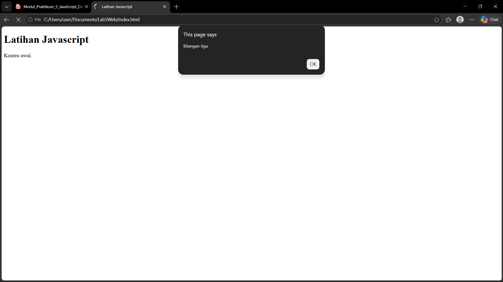
*Latihan 5: pilihan valid*


*Latihan 5: pilihan tidak tersedia*

## Latihan 6: Form Bilangan Genap atau Ganjil

**Tujuan:** memeriksa bilangan dari form dan menampilkan hasilnya pada halaman. Elemen form sudah ada pada `index.html` di atas; function-nya sebagai berikut.

```javascript
function cekBilangan() {
  const input = document.getElementById("bilangan").value;
  const angka = Number(input);
  const hasil = document.getElementById("hasilBilangan");

  if (input.trim() === "" || !Number.isInteger(angka)) {
    hasil.textContent = "Masukkan bilangan bulat yang valid.";
  } else if (angka % 2 === 0) {
    hasil.textContent = "Bilangan genap";
  } else {
    hasil.textContent = "Bilangan ganjil";
  }
}
```

**Hasil pengujian:**

| Masukan | Hasil di halaman |
|---|---|
| 8 (positif) | Bilangan genap |
| 7 (positif) | Bilangan ganjil |
| -4 (negatif) | Bilangan genap |
| -3 (negatif) | Bilangan ganjil (`-3 % 2` bernilai `-1`, bukan 0) |
| 0 | Bilangan genap |
| 3.5 (desimal) | Masukkan bilangan bulat yang valid. |
| Kosong | Masukkan bilangan bulat yang valid. |


*Latihan 6: bilangan genap*

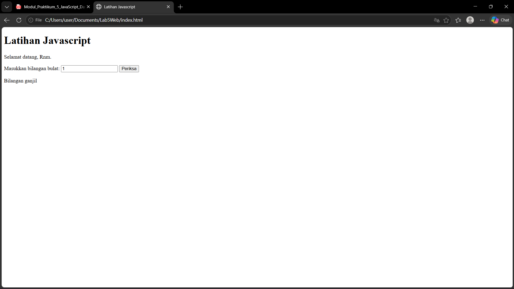
*Latihan 6: bilangan ganjil*

## Latihan 7: Mengubah Warna Halaman

**Tujuan:** mengubah warna latar dengan tiga tombol yang memakai satu function berparameter, sehingga kode tidak berulang.

```javascript
function ubahWarnaLatar(warna) {
  document.body.style.backgroundColor = warna;
}
```

```html
<button type="button" onclick="ubahWarnaLatar('lightgreen')">Latar Hijau</button>
<button type="button" onclick="ubahWarnaLatar('white')">Latar Putih</button>
<button type="button" onclick="ubahWarnaLatar('lightyellow')">Latar Kuning</button>
```

**Hasil:** tombol Latar Hijau mengubah latar menjadi hijau muda, Latar Putih menjadi putih, dan Latar Kuning menjadi kuning muda. Ketiganya memakai function yang sama dengan argumen warna yang berbeda.

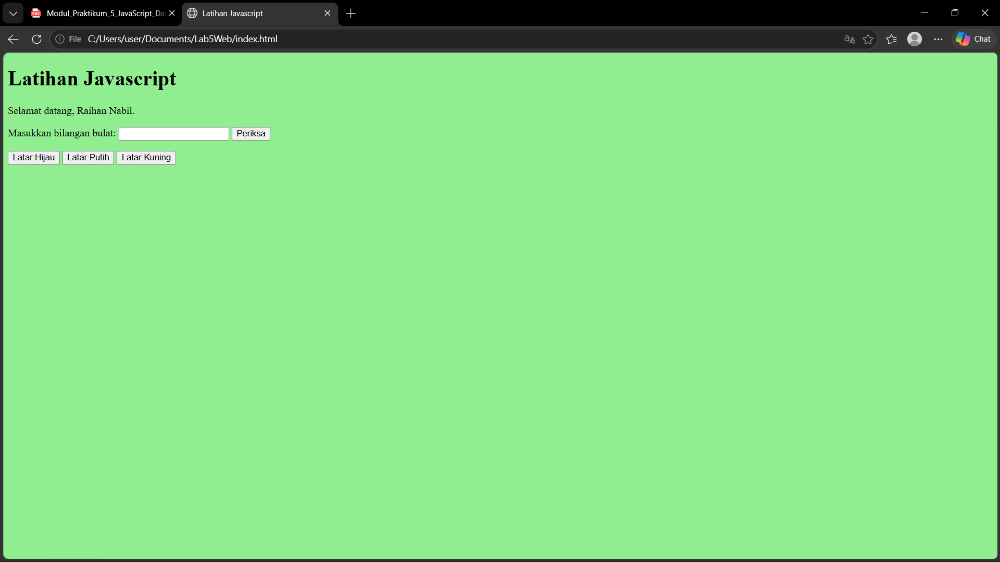
*Latihan 7: latar hijau*

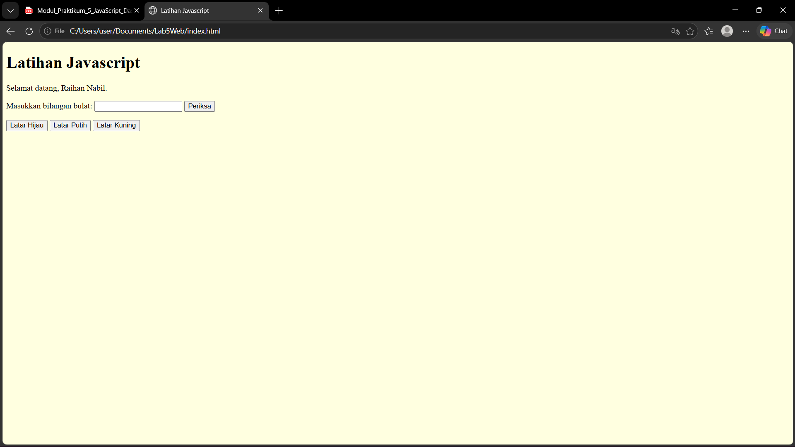
*Latihan 7: latar kuning*

## Latihan 8: DOM dan Checkbox Menu Makanan

**Tujuan:** menghitung total harga secara otomatis ketika checkbox dicentang atau dilepas. Daftar menu sudah ada pada `index.html` (sudah ditambah dua menu pada Eksperimen 5).

```javascript
const daftarMenu = document.querySelectorAll(".menu");
daftarMenu.forEach((item) => {
  item.addEventListener("change", hitungTotal);
});

function hitungTotal() {
  let total = 0;
  daftarMenu.forEach((item) => {
    if (item.checked) total += Number(item.value);
  });
  document.getElementById("total").textContent = total.toLocaleString("id-ID");
}
```

**Hasil pengujian** (dengan tiga menu bawaan modul):

| Pilihan | Total |
|---|---|
| Tidak ada yang dicentang | Rp0 |
| Ayam Goreng | Rp5.000 |
| Ayam Goreng + Tempe | Rp5.500 |
| Ayam Goreng + Tempe + Telur Dadar | Rp8.000 |
| Tempe dilepas dari pilihan di atas | Rp7.500 |

`toLocaleString("id-ID")` memformat angka dengan titik sebagai pemisah ribuan. Event `change` membuat total diperbarui setiap kali centang berubah.

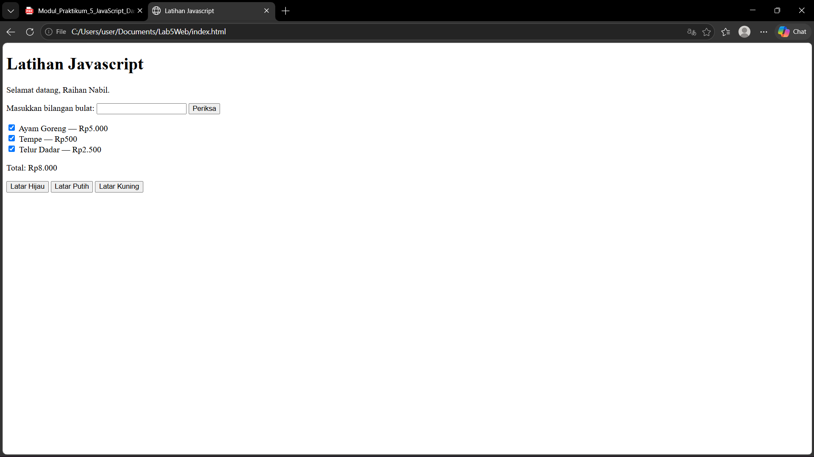
*Latihan 8: semua menu dipilih*

## Mini Project: Kalkulator Nilai Mahasiswa

**Tujuan:** menerima nilai tugas, UTS, dan UAS lewat form, menghitung nilai akhir, menentukan predikat, dan menampilkan status kelulusan pada halaman HTML.

**Berkas:** `mini_project.html` dan `mini_project.js`.

### Rancangan

- **Perhitungan** dipisahkan dari tampilan: `hitungNilaiAkhir()` (bobot tugas 30%, UTS 30%, UAS 40%), `tentukanPredikat()`, dan `tentukanStatus()`.
- **Validasi** pada `validasiNilai()`: kolom tidak boleh kosong, harus berupa angka, dan berada pada rentang 0–100. Jika tidak valid, pesan kesalahan tampil di halaman.
- **Tampilan** dikerjakan oleh `tampilkanHasil()` dan `tampilkanError()`; hasil tampil di halaman, bukan hanya di Console.
- Event `submit` pada form memanggil validasi, perhitungan, lalu tampilan.

```javascript
function hitungNilaiAkhir(tugas, uts, uas) {
  return tugas * 0.30 + uts * 0.30 + uas * 0.40;
}

function tentukanPredikat(nilai) {
  if (nilai >= 85) return "A";
  if (nilai >= 75) return "B";
  if (nilai >= 60) return "C";
  if (nilai >= 50) return "D";
  return "E";
}

function tentukanStatus(nilai) {
  return nilai >= 60 ? "Lulus" : "Belum lulus";
}

function validasiNilai(teks) {
  if (teks.trim() === "") return null;
  const angka = Number(teks);
  if (Number.isNaN(angka) || angka < 0 || angka > 100) return null;
  return angka;
}
```

Potongan di atas adalah bagian perhitungan dan validasi. Kode lengkap, termasuk bagian tampilan dan event handler, ada pada `mini_project.js`.

### Hasil pengujian

| No | Tugas | UTS | UAS | Nilai akhir | Predikat | Status | Keterangan |
|---|---|---|---|---|---|---|---|
| 1 | 85 | 78 | 88 | 84.10 | B | Lulus | Contoh pada modul |
| 2 | 90 | 95 | 92 | 92.30 | A | Lulus | Nilai tinggi |
| 3 | 40 | 45 | 50 | 45.50 | E | Belum lulus | Nilai rendah |
| 4 | 60 | 60 | 60 | 60.00 | C | Lulus | Batas kelulusan |
| 5 | 55 | 50 | 52 | 52.30 | D | Belum lulus | Predikat D |
| 6 | 150 | 80 | 80 | - | - | - | Pesan kesalahan validasi |

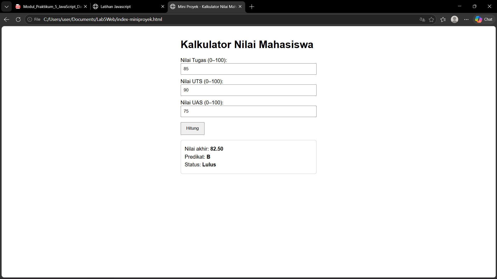
*Mini Project: skenario 1 (lulus)*


*Mini Project: skenario 2 (tidak lulus)*

## Eksperimen Mandiri

Modul menomori eksperimen 1, 7, 8, 9, 10, dan 11. Pada laporan ini dinomori ulang berurutan 1–6.

### Eksperimen 1: Latihan 3 dengan masukan dari prompt

```javascript
const inputA = prompt("Masukkan bilangan pertama:");
const inputB = prompt("Masukkan bilangan kedua:");
const angkaA = Number(inputA);
const angkaB = Number(inputB);

if (inputA === null || inputB === null ||
    inputA.trim() === "" || inputB.trim() === "" ||
    Number.isNaN(angkaA) || Number.isNaN(angkaB)) {
  alert("Input tidak valid. Masukkan dua bilangan.");
} else {
  operasiDasar(angkaA, angkaB);
}
```

**Hasil:** masukan `9` dan `4` menghasilkan keluaran yang sama dengan Latihan 3. Masukan `10` dan `0` menampilkan "Tidak dapat dibagi nol" pada Pembagian dan Modulus. Masukan huruf, kosong, atau Cancel menampilkan alert "Input tidak valid". Pengecekan `null` dan string kosong diperlukan karena `Number(null)` dan `Number("")` sama-sama bernilai 0.

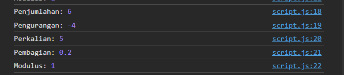
*Eksperimen 1: hasil di Console*

### Eksperimen 2: Tabel perkalian 7 dari 1 sampai 10

```javascript
for (let i = 1; i <= 10; i++) {
  console.log("7 x " + i + " = " + (7 * i));
}
```

**Hasil:** Console menampilkan sepuluh baris, dari `7 x 1 = 7` sampai `7 x 10 = 70`. Tanda kurung pada `(7 * i)` diperlukan agar perkalian dihitung sebelum penyambungan teks.

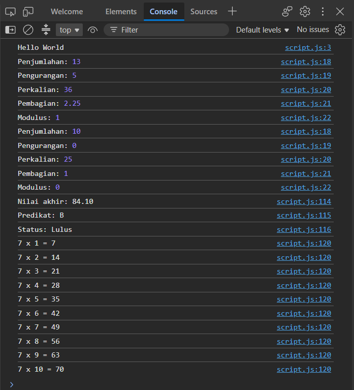
*Eksperimen 2: tabel perkalian 7*

### Eksperimen 3: Function cekGenap(angka)

```javascript
function cekGenap(angka) {
  return angka % 2 === 0;
}

console.log("cekGenap(4):", cekGenap(4));     // true
console.log("cekGenap(7):", cekGenap(7));     // false
console.log("cekGenap(0):", cekGenap(0));     // true
console.log("cekGenap(-6):", cekGenap(-6));   // true
console.log("cekGenap(-3):", cekGenap(-3));   // false
```

**Hasil:** function mengembalikan `true` untuk bilangan genap dan `false` untuk ganjil. Pengecekan memakai `=== 0` (bukan `=== 1` untuk ganjil) karena pada bilangan negatif sisa baginya bisa `-1`.

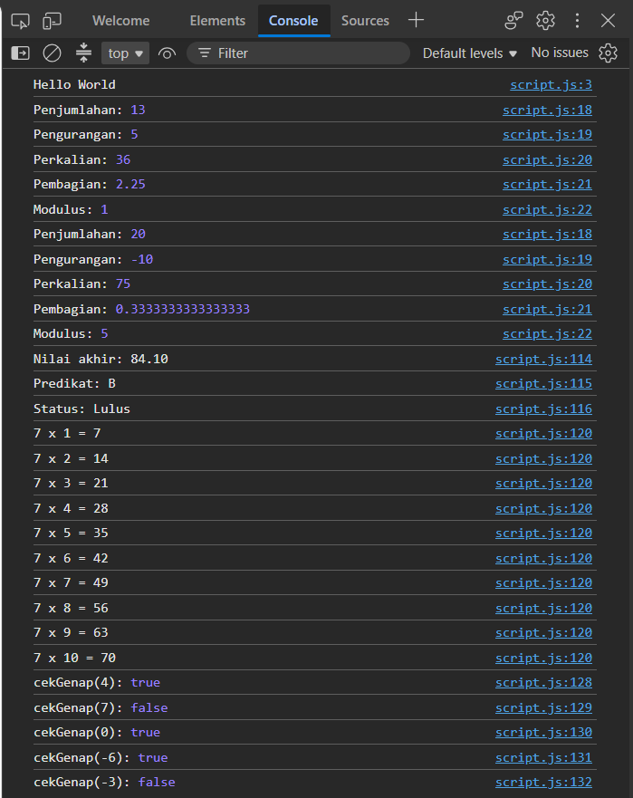
*Eksperimen 3: hasil cekGenap di Console*

### Eksperimen 4: Validasi kolom form tidak boleh kosong

```javascript
document.getElementById("formKosong").addEventListener("submit", function (event) {
  event.preventDefault();

  const nama = document.getElementById("namaForm").value;
  const email = document.getElementById("emailForm").value;
  const pesan = document.getElementById("pesanForm");

  if (nama.trim() === "" || email.trim() === "") {
    pesan.style.color = "red";
    pesan.textContent = "Semua kolom wajib diisi.";
  } else {
    pesan.style.color = "green";
    pesan.textContent = "Data berhasil dikirim: " + nama.trim() + " (" + email.trim() + ")";
  }
});
```

**Hasil:** jika salah satu atau kedua kolom kosong (termasuk hanya berisi spasi), muncul pesan merah "Semua kolom wajib diisi." Jika keduanya terisi, muncul pesan hijau berisi data yang dikirim. `preventDefault()` mencegah halaman dimuat ulang, dan `trim()` membuat input berisi spasi dianggap kosong.

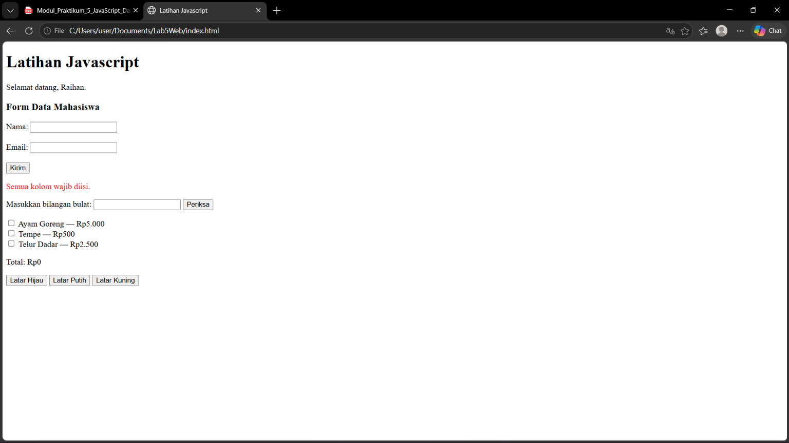
*Eksperimen 4: kolom kosong*

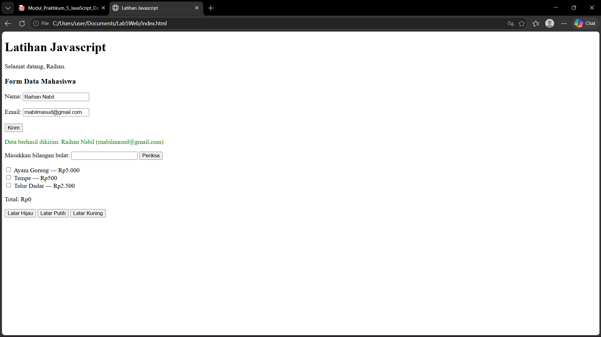
*Eksperimen 4: data valid*

### Eksperimen 5: Menambah dua menu pada Latihan 8

```html
<label><input type="checkbox" class="menu" value="3000"> Nasi Putih — Rp3.000</label><br>
<label><input type="checkbox" class="menu" value="2000"> Es Teh — Rp2.000</label><br>
```

**Hasil:** `script.js` tidak perlu diubah karena `querySelectorAll(".menu")` mengambil semua elemen ber-class `menu`. Dengan lima menu, total berubah sesuai pilihan: Nasi Putih saja Rp3.000, ditambah Es Teh Rp5.000, dan semua menu dicentang Rp13.000.

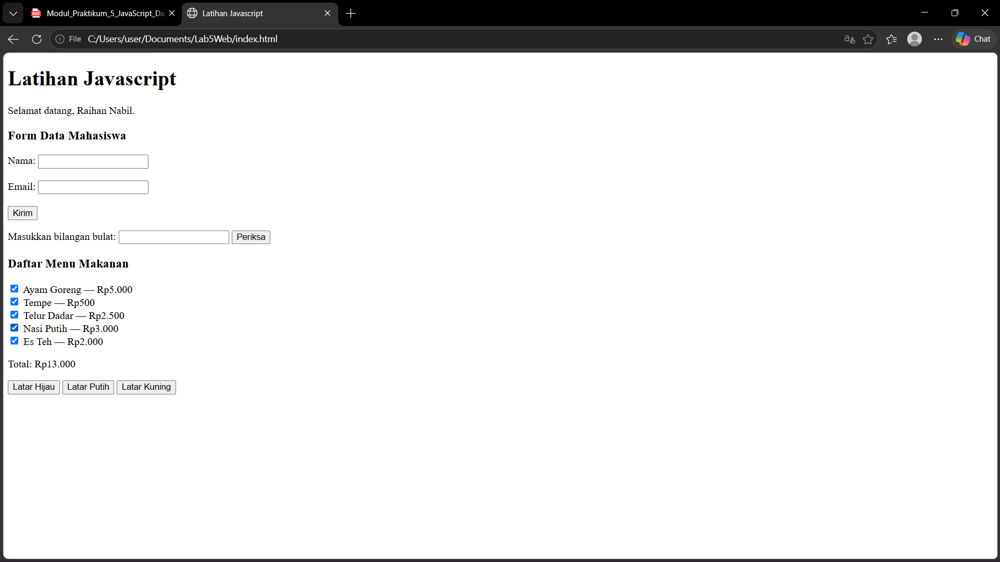
*Eksperimen 5: lima menu, semua dipilih*

### Eksperimen 6: Tombol sembunyikan/tampilkan elemen

```javascript
const tombolToggle = document.getElementById("tombolToggle");
const elemenToggle = document.getElementById("elemenToggle");

tombolToggle.addEventListener("click", function () {
  if (elemenToggle.style.display === "none") {
    elemenToggle.style.display = "block";
    tombolToggle.textContent = "Sembunyikan";
  } else {
    elemenToggle.style.display = "none";
    tombolToggle.textContent = "Tampilkan";
  }
});
```

**Hasil:** klik pertama menyembunyikan teks dan mengubah tombol menjadi "Tampilkan"; klik berikutnya menampilkan teks kembali dan mengembalikan tombol menjadi "Sembunyikan".

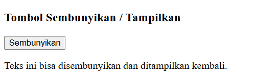
*Eksperimen 6: elemen tampil*

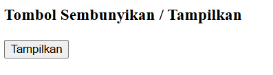
*Eksperimen 6: elemen tersembunyi*
